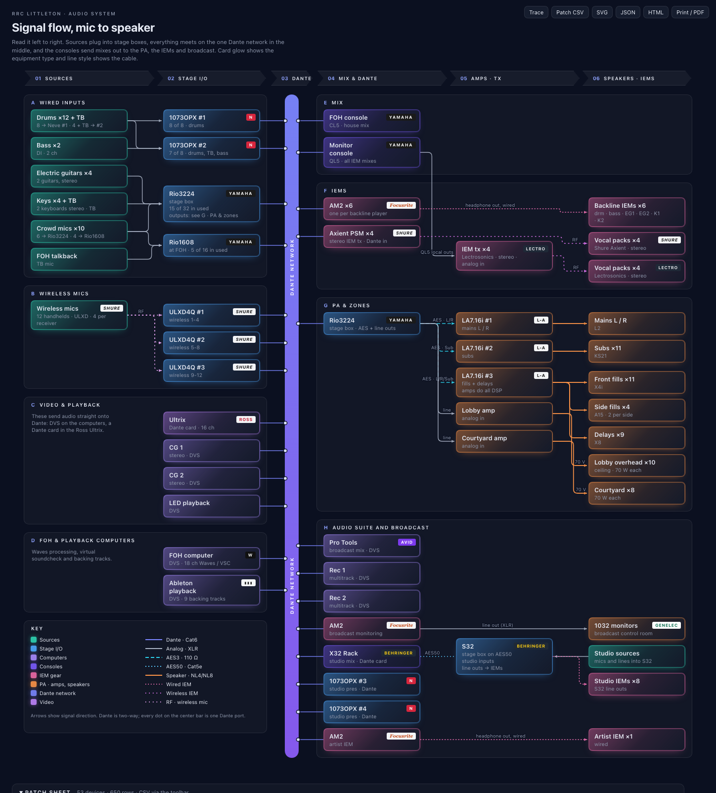

# Fathom

**Know your AV system.** Fathom documents audio, video and lighting
systems room by room: every device with its real ports, every cable
port-to-port with its tag, the network, DMX patch, racks, floor plans and
inventory. It reads the exports you already have (Yamaha console CSV, Dante
Controller presets and Device Info, Waves racks, ETC Eos / USITT ASCII /
Lightwright patch, Blackmagic Videohub dumps, ATEM settings, any device or
cable spreadsheet) and turns them into a live "stage to speaker to stream"
map, an interactive patch view, schedules, printable labels, QR-coded device
pages and a troubleshooting assistant. It runs as a small web app you can
host on a NAS, a Pi or a server, with a read-only viewer to hand to
volunteers.



- **App** (`/`): rooms, patch view (drag port to port), patch table, floor
  plans with device markers, rack elevations, schedules, inventory, imports,
  history, assistant. Works on desktop, iPad and phones; installable (PWA).
- **Viewer** (`/p/<project>`): the rendered map per room, device pages (the
  QR target), read-only patch tables. Hover or tap a card for details, click
  to light every path it is part of.
- **Builds**: dated packages (maps, schedules as CSV, label sheet, rack and
  floor-plan SVGs, device pages, QR codes, report, zip) for handing out.
- **CLI**: everything from the terminal (`fathom build`, `fathom trace
  rio-sl:analog-in-1 --up`, `fathom schedule cables`, `fathom ask`).

Pure Python standard library (3.9+). No database: projects are folders
under one data directory, with full revision history.

## Run it

### Docker (recommended for hosting)

```bash
docker compose up -d          # http://localhost:8080  · data in the fathom-data volume
```

Or without compose:

```bash
docker build -t fathom .
docker run -d --name fathom -p 8080:8080 -v fathom-data:/data fathom
```

The image includes `poppler-utils` so PDF floor plans convert out of the box.

### Locally

```bash
pip install .                 # or: pip install -e ".[dev]"
fathom serve --open           # http://127.0.0.1:8080, data in ~/.fathom
fathom demo --open            # build the bundled v1 sample (RRC Littleton)
fathom new campus --template campus-demo && fathom build campus --open
```

Without installing: `python -m fathom serve` from this folder.

### Settings (environment variables)

| Variable | Purpose |
| --- | --- |
| `FATHOM_DATA` | data directory (`/data` in the image, `~/.fathom` otherwise) |
| `FATHOM_HOST`, `FATHOM_PORT` | dev-server bind address (default `127.0.0.1:8080`) |
| `FATHOM_AUTH` | `user:pass[,user2:pass2]` bootstrap admin logins; with neither this nor users (`fathom user add`) the app is open, as in 0.2 |
| `FATHOM_PUBLIC_VIEW=1` | keep the viewer (`/p/*`) and build downloads public while the app needs a login |
| `FATHOM_PUBLIC_URL` | base URL encoded in device QR codes (or `settings.public_url` per project), e.g. `https://av.example.org` |
| `FATHOM_MAX_UPLOAD_MB`, `FATHOM_MAX_JSON_MB` | request size caps (default 50 / 20) |
| `FATHOM_MAX_BACKUP_MB` | largest backup zip accepted by *Upload and restore* (default 4096) |
| `FATHOM_CHROME`, `FATHOM_CHROME_NO_SANDBOX` | Chrome / Chromium for server-side PDF / PNG (`--build-arg WITH_CHROMIUM=true` installs one) |
| `FATHOM_PDF_RASTERIZER` | command template for PDF floor plans, e.g. `pdftoppm -f {page} -l {page} -r {dpi} -png -singlefile {in} {out}` (`{page}` is 0-based); otherwise `pdftoppm`, `mutool`, `gs` or macOS `sips` is used when found |
| `FATHOM_ODA`, `FATHOM_ODA_XVFB=1` | ODA File Converter binary for DWG floor plans (optionally under `xvfb-run`) |
| `FATHOM_PLUGINS` | plugin directories (`os.pathsep`-separated) with importer modules (`register(api)`) |
| `FATHOM_LIBRARY` | extra equipment-template directories (`*.json`) |
| `FATHOM_CHECKLISTS` | extra assistant checklist directories |
| `FATHOM_LLM_URL`, `FATHOM_LLM_MODEL`, `FATHOM_LLM_API_KEY`, `FATHOM_LLM_TIMEOUT`, `FATHOM_LLM_MAX_CONTEXT` | optional OpenAI-compatible endpoint that rewords assistant answers (the answer itself is always computed locally) |

Put it behind your reverse proxy with TLS for anything beyond a trusted LAN.
The app binds `0.0.0.0:8080` in the container; the dev server binds
`127.0.0.1` unless you pass `--host`.

## The model in one screen

A project is one `project.json` (schema 2): venues → rooms → systems and
locations; racks; networks; **devices with explicit ports**; **cables from
port to port** (with tag, type, length, colour, status) and bundles; floor
plans with markers; attachments; project templates; imports. 0.2 projects
(`"fathom": 1`) load unchanged and are migrated in memory; the first save
writes schema 2 and keeps `project.v1.json`. `fathom migrate <project>`
shows what changes.

- **34 device kinds** in 7 disciplines (audio, video, lighting, network,
  control, power, other) and **41 media** (Dante, analog, AES3, MADI, SDI,
  HDMI, HDBaseT, NDI, ST 2110, DMX, sACN, Art-Net, RS-232, GPIO, power …),
  each with a colour and line style: `fathom vocab`.
- Status `installed`, `planned`, `spare`, `retired`; builds and schedules
  can be cut to *as built* or *planned*.
- **Equipment library**: 57 starter templates (consoles, stage boxes,
  wireless, amps, switchers, routers, cameras, projectors, lighting desks and
  fixtures, switches, control processors …) with real port lists. Add your
  own globally (`<data>/library/*.json`), per project, or from a directory
  (`FATHOM_LIBRARY`). `fathom library list -q rio`.

## Inputs

| Export | How to get it | What Fathom reads |
| --- | --- | --- |
| **Yamaha CL / QL / TF / DM CSV** | Editor `File › CSV File Export` (upload the folder) | channel names, colours, icons, input and output patch, bus names; Omni names become port labels |
| **Dante Controller** | `File › Save Preset` (`.xml`); Receive-tab "Copy Entire Table"; Device Info tab copy | devices, channel labels, every subscription (routes); Primary / Secondary Address → IP schedule |
| **Waves racks** | SuperRack / MultiRack session or a CSV `rack,input,output,plugins,notes` | racks, I/O, plugin chains |
| **ETC Eos / USITT / Lightwright** | Eos `File › Export › CSV`; USITT ASCII `.asc`; Lightwright / Vectorworks instrument schedule (tab or comma text) | channel, universe/address, fixture type, footprint, position, purpose; matched to fixtures, the rest appear as overlay fixtures you can promote |
| **Blackmagic Videohub** | text captured from the router on TCP 9990 (`nc <ip> 9990 > dump.txt`) | input/output labels and routing |
| **ATEM settings** | ATEM Software Control `File › Save As` (`.xml`) | input names as port labels |
| **Device / cable CSV** | any spreadsheet (headers like `name, kind, model, room, serial, ip` or `from_device, from_port, to_device, to_port, tag, type, length`) | one-shot: previewed as changes, then applied; the cable schedule CSV re-imports the same way |
| **Floor plans** | PNG, JPG, SVG, PDF, Draw.io (`.drawio`, compressed or not), DXF (ASCII) | DXF layers and units, Draw.io shapes and edges; DWG needs DXF/PDF/SVG export or `FATHOM_ODA` |

Imports never overwrite what you typed: their results form an **overlay**
(routes, labels, addresses, DMX rows, auto devices) shown in italics, which
you can keep or promote.

## CLI

```text
fathom serve [--host H] [--port N] [--data DIR] [--open]
fathom new <name> [--template blank|rrc-littleton|campus-demo] [--org O]
fathom import <project> <file|folder>... [--kind auto|yamaha|dante|waves|eos|videohub|csv|atem] [--node ID] [--room R] [--apply]
fathom inspect <file|folder> [--kind K] [--json]
fathom build <project> [--pdf] [--png] [--open] [--out DIR] [--state all|planned|as_built] [--rooms a,b] [--base-url URL]
fathom trace <project> <from> [<to>] [--discipline D] [--up]     cards (v0.2) or dev:port
fathom patch <project> [--csv]
fathom schedule patch|cables|ip|dmx|bom|inventory|racks|labels <project> [--room R] [--state S] [--csv|--json]
fathom tags <project> [--scope missing|all] [--apply]             cable tags from settings.cable_tag_pattern
fathom qr <project> [device] [--base-url URL] [--out F] | fathom qr --text T [--ascii]
fathom plan convert <file> [--out F] [--page N] [--hide L1,L2]
fathom ask <project> "<question>" [--room R] [--json] [--no-llm]
fathom library list [-q Q] [--discipline D] [--kind K] | fathom library show <id>
fathom migrate <project> [--write] · fathom history <project> · fathom restore <project> <rev>
fathom user add <name> [--role viewer|editor|admin] [--password-stdin] | list | passwd <name> | role <name> <role> | remove <name>
fathom backup create [--include-builds] [--label L] [--out F] | list | restore <file.zip|name> [--yes] [--no-safety]
fathom vocab [--json] · fathom plugins · fathom validate <project> · fathom list · fathom status · fathom demo · fathom selftest
```

Cable tags follow `settings.cable_tag_pattern` (default `{D}-{n:03}`:
discipline letter and a number, `A-001`, `V-003`). Tokens: `{D}`, `{disc}`,
`{DISC}`, `{M}` (medium short name), `{room}`, `{from}`, `{to}`, `{n}` /
`{n:03}`.

## Data layout

```text
$FATHOM_DATA/
  users.json  secret.key                     logins (fathom user …) and the session key
  backups/fathom-backup-<stamp>.zip          whole-server backups (Settings › Backups, fathom backup)
  library/<template-id>.json                 your global equipment templates
  projects/<name>/project.json               the model (schema 2, with "revision")
  projects/<name>/project.v1.json            the original 0.2 file, kept once after migration
  projects/<name>/exports/<kind>/...         copies of imported exports
  projects/<name>/files/<att-id>/<file>      photos, documents, floor-plan sources and renders
  projects/<name>/history/                   index.jsonl, ops/<rev>.json, snap/<rev>.json
  builds/<name>/<YYYY-MM-DD_HHMMSS>_<slug>/  build packages (below)
```

A build folder holds `index.html` + `diagram.svg` + `patch-sheet.csv` (the
0.2 artifacts, default room), `project.json`, `build-notes.txt`,
`rooms/<room>/{index.html,diagram.svg,patch.html}`, `rooms/index.html`,
`devices/<device>.html`, `patch-table.csv`, `cable-schedule.csv`,
`cable-labels.html`, `ip-schedule.csv`, `dmx-schedule.csv`, `bom.csv`,
`inventory.csv`, `racks/<rack>-{front,rear}.svg`, `floorplans/<plan>.svg`,
`qr/<device>.svg` (when a public URL is known), `report.html`, optional
`report.pdf` / `diagram.png`, and `<run>.zip`. Every link is relative, so the
folder works from `file://`.

Back up the data directory and you have everything.

### Backup and restore

Admins get **Settings › Backups**. *Back up now* zips every project (with
history, attachments, floor plans and imports), `users.json`, `secret.key`
and the custom library into `backups/` and downloads a copy; tick *Include
builds* to add the rendered packages. Keep the downloaded copy off the
server, and treat it like a password file (it holds password hashes).

*Upload and restore* (or *Restore* on a listed backup) verifies the zip,
saves the current state as a `…-pre-restore.zip` backup, then swaps the
backup's data in. Builds are only replaced when the backup includes them;
`backups/` itself is never touched. Restoring brings back the backup's user
accounts, so you may have to sign in again. From a shell, e.g. inside the
container:

```bash
docker exec fathom fathom backup create              # prints the backup name
docker cp fathom:/data/backups/fathom-backup-20261021-183105.zip .
docker cp ./fathom-backup-20261021-183105.zip fathom:/tmp/
docker exec -it fathom fathom backup restore /tmp/fathom-backup-20261021-183105.zip
```

## Extending

A plugin is a `.py` file (or package) in a `FATHOM_PLUGINS` directory:

```python
from fathom.plugins import Importer

def register(api):
    api.register_importer(Importer(kind="mything", label="My thing export",
                                   detect=lambda path: 0.9 if path.suffix == ".thing" else 0.0,
                                   parse=parse_thing, contribute=contribute_thing, accepts=(".thing",)))
    api.register_template_dir(__file__.rsplit("/", 1)[0] + "/templates")
```

`contribute(result, doc, ctx)` returns overlay data (`devices`, `routes`,
`port_labels`, `interfaces`, `dmx`, `detail`, `notes`). `fathom plugins`
lists importers and load errors.

## Development

```bash
python -m pip install -e ".[dev]"
python -m unittest discover -s tests     # backend tests (also: /usr/bin/python3 for 3.9)
node --test tests/js/*.test.mjs          # frontend cores
python -m fathom selftest                # parse the samples, migrate, build, QR / DXF / Draw.io checks
python -m fathom serve --open
```

Module map: `vocab.py` (kinds, media, disciplines), `schema.py` (model v2,
migration, ops, validation), `project.py` / `history.py` / `users.py`
(storage, revisions, logins), `plugins.py` + `parsers/` (importers),
`merge.py` (0.2 merge + import overlay), `dedupe.py` (duplicate-device
suggestions and merge plans), `library/` (templates),
`floorplan.py` (DXF / Draw.io / PDF / SVG), `cables.py`, `network.py`,
`bom.py`, `qr.py`, `racks.py`, `dmx.py`, `patch.py`, `trace.py`, `search.py`,
`assistant.py` / `llm.py`, `layout.py` / `render_html.py` / `render_svg.py`
(maps and viewer pages), `export.py` (builds), `server.py` (WSGI app),
`static/` (app). Samples: `samples/rrc-littleton` (0.2 project),
`samples/campus-demo` (three rooms, audio/video/lighting, every importer),
`samples/floorplans` (one file per supported format).

## Limits

- DWG is a closed format: export DXF, PDF or SVG, or configure the ODA File
  Converter. Binary DXF is not read; save ASCII DXF.
- PDF floor plans need a rasterizer on the server (`pdftoppm` is in the
  Docker image).
- Waves session files (`.sprk`) are undocumented; the CSV fallback is the
  reliable path. The console CSV carries names, colours and patching, not
  gain, sends or inserts.
- Imports read files you export; there is no live discovery (Dante mDNS,
  Videohub TCP, sACN, SNMP).
- Port counts of templates marked "not verified" come from general
  knowledge; check them against the datasheet.
